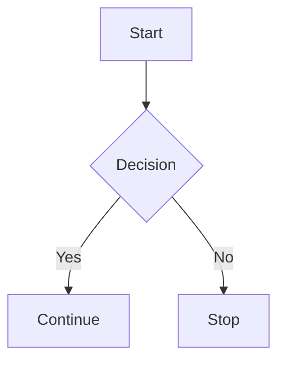

# Lectern Flavor

The file format spec for every app in the suite.

Lectern never invents a binary format. Every file it writes is UTF-8 text you
can open in any editor, diff in git, and — for the document and diagram types —
read in a plain Markdown viewer without losing the words. This document is the
reference for what is actually written to disk, so a file stays readable even if
this app disappears.

Everything here is implemented in [`main.js`](main.js); the Markdown extensions
specifically live in `configureMarkedExtensions`. The base parser is
[marked](https://github.com/markedjs/marked) v9.1.6 with GFM enabled, so
**everything CommonMark and GitHub Flavored Markdown support works unchanged** —
tables, task lists, strikethrough, fenced code, autolinks. The extensions below
are additions, never replacements.

## File types

| Extension | App | Format |
|---|---|---|
| `.mdp` | Documents | Markdown + the extensions below |
| `.mdg` | Diagrams | Markdown wrapper around one Mermaid block |
| `.mds` | Sheets | Line-oriented text with a YAML front-matter header |
| `.mdn` | Notebook / Maps | Markdown wrapper around a JSON block |
| `.mdd` | Slides | Line-oriented text: YAML front matter, `--- N ---` slides |
| `.mdl` | Glossary | JSON |
| `.mdc` | Calendar | JSON |
| `.mde` | Economy | JSON |
| `.mdb` | Bestiary | JSON |

The first four degrade gracefully: rename a `.mdp` to `.md` and GitHub renders
it. The last four carry an `.md*` extension for consistency with the rest of the
suite, but their contents are plain JSON, not Markdown — see
[Structured data files](#structured-data-files).

---

# Documents (`.mdp`)

## Math — KaTeX

```
Inline: $E = mc^2$ appears mid-sentence.

$$
\int_0^\infty e^{-x^2}\,dx = \frac{\sqrt{\pi}}{2}
$$
```

Registered as parser-level tokenizers rather than a post-render pass, so
Markdown emphasis rules never mangle TeX source (`a_1` and `b_2` on one line
does not become italics).

Inline math uses Pandoc's currency guard: the TeX must not begin or end with
whitespace, and the closing `$` must not be followed by a digit. So `$5 and $10`
stays literal text. Write `\$` for a literal dollar sign inside math.

If KaTeX fails to parse the expression, the source is rendered as inline code
rather than throwing.

## Diagrams — Mermaid

A fenced block tagged `mermaid` renders as a live diagram:

````

````

Every other language falls through to normal `<pre><code>` rendering.

## Alignment and font blocks

Two spellings exist for the same thing. The keyword form is explicit; the
symbol form is what the toolbar buttons write, because it is quieter in raw
text.

**Keyword form** — `:::` followed by one or more directives on the opening line,
closed by a bare `:::`:

```
::: center
Centered paragraph, and **all Markdown inside still works**.
:::

::: right font="Times New Roman"
Right-aligned, in Times.
:::
```

Recognized directives: the bare words `left`, `center`, `right`, `justify`, and
`font=<name>` (quote the value if it contains spaces). Unrecognized directives
are ignored, and if a block's opening line yields no recognized directive at all
the block is not treated as a container — the `:::` lines stay literal text.

**Symbol form** — the symbol alone on its own line, closed by the exact same
symbol:

| Symbol | Effect |
|---|---|
| `::` | Align left |
| `:::` | Align right |
| `;;` | Align center |
| `;;;` | Justify |
| `\|\|` + font name | Set font family |

```
;;
This paragraph is centered.
;;

||Georgia
This paragraph is set in Georgia.
||
```

The symbol form requires nothing after the symbol on the opening line, which is
what keeps `:::` (right-align) from colliding with `::: center` (keyword form) —
the keyword form always has trailing text.

## Inline font

```
A line with [these three words]{font=Georgia} set differently.
[Quoted title]{font="Times New Roman"}
```

## Table of contents

```
[TOC]
```

Alone on its line, case-insensitive. Expands to a nested list of every heading
in the document, linked to the heading anchors. Headings are given `id`
attributes derived from their text: lowercased, non-alphanumerics stripped,
spaces collapsed to `-`. Repeated headings are disambiguated with a numeric
suffix — the second `## Notes` in a file gets `id="notes-1"`.

## Roman-numeral lists

```
i. First
ii. Second
iii. Third
```

Renders as a real ordered list with roman markers. Both `.` and `)` terminate
the marker. Lowercase and uppercase are separate lists — a case switch starts a
new one. A *single* roman item only counts as a list when it starts at `i`/`I`,
so prose like `c. 1450` is left alone. Arabic `1.` lists are standard Markdown
and behave exactly as they always did.

## Field cards

Key–value metadata rendered as a styled card rather than a paragraph.

One line, fields laid out side by side:

```
{type: Character, status: Active, faction: Ironhold, race: Human}
```

Braces on their own lines, one field per row:

```
{
type: Location,
region: Northmarch,
climate: Subarctic,
}
```

The multi-line form requires *every* non-empty inner line to look like
`key: value` (a trailing comma is optional). If any line does not, the block is
left as ordinary text — so stray braced content in a document is never eaten.

Field cards are what the built-in document templates (Character, Faction,
Location, Event, Region) put at the top of a new file.

## Tags

```
This entry is a #character from #northmarch.
```

`#word` renders as a clickable pill that filters the sidebar to files carrying
that tag. Matching requires a word character immediately after the `#`
(`[\w-]+`), so ATX headings — which always have a space — never collide.

## Task lists

Standard GFM task list syntax, but the rendered checkboxes are live: ticking one
in the preview writes the change back to the source.

```
- [ ] Draft the siege chapter
- [x] Name the river
```

## Cross-file links and embeds

Links between files in the workspace use a private URL scheme:

```
lorekeep://file/<url-encoded file id>
```

Written by the link toolbar, not by hand. Two forms:

**Link** — `[Kaelith Vance](lorekeep://file/f_1737059412345)` navigates to that
file.

**Embed** — the image form pulls live content out of another file *into* this
document:

```

```

- Target is a **Diagram** → its Mermaid block is rendered inline as a figure,
  with the alt text as the caption.
- Target is a **Sheet** → every chart defined in that sheet is rendered inline
  from the sheet's live cell values.
- Target is missing → a visible `[File not found: …]` placeholder, never a
  silent blank.

Any `href` that is not this scheme is treated as a normal link, so ordinary web
URLs and relative paths are untouched.

### Backlinks

Backlinks are derived, not authored. The app scans file contents for mentions of
other files by name and stores the resulting index in `_lkbl.json` at the
work-folder root (shape: `{ targetFileId: [sourceFileId, …] }`). **Files are
never modified to record backlink data** — delete `_lkbl.json` and it is rebuilt.

---

# Diagrams (`.mdg`)

A type marker comment followed by a single Mermaid block:

````
<!-- type: graph -->


````

When a document embeds a diagram file, the *first* Mermaid block in the file is
the one that gets rendered.

---

# Sheets (`.mds`)

YAML front matter, then one section per tab, then an optional chart block.

```
---
type: spreadsheet
---

# Population
A1=Region
B1=Households
A2=Northmarch
B2=1400
B9=SUM(B2:B8)=9310
```

## Cell lines

One line per non-empty cell, `REF=VALUE`, sorted row-major. Cells are written
from each page's own contents rather than clipped to the visible grid, so a
value far outside the current viewport is never silently dropped.

**Formulas serialize with their last computed result appended:**

```
B9=SUM(B2:B8)=9310
```

That is `REF` `=` `formula body` `=` `cached value`. The cached value is what
lets another tool — or a document embedding this sheet's chart — read meaningful
numbers without implementing the formula engine. On load the formula is
authoritative and the cache is recomputed.

## Cell decorations

Suffixes on the cell line, in any order:

| Suffix | Meaning | Example |
|---|---|---|
| `:REF,REF,…` | Merge — this cell is the anchor, the listed refs are covered | `B1=Totals:B2,B3,B4` |
| `;#rrggbb` | Background color | `B1=5;#FAFAFA` |
| `;txt#rrggbb` | Text color | `B1=5;txt#FF0000` |

A cell that has only a decoration and no value still gets a line, so formatting
survives a round trip.

## Multiple tabs

Each tab is a `#` heading followed by its cells:

```
# Population
A1=Northmarch

# Trade
A1=Silk
```

Formulas reference another tab with a link-like syntax — `[Tab name](REF)`:

```
B2=[Population](B9) * 0.4=3724
```

## Charts

Chart definitions are appended as a single fenced JSON block:

````
```charts
[{"id":"c1","type":"bar","range":"A1:B8"}]
```
````

Live Chart.js instances are never serialized — they are rebuilt from these
definitions and the current cell values on every render.

## Formula language

79 functions across six categories — Aggregate, Math, Trigonometry, Lookup, Text
and Logical. The in-app function reference (the `fx` button) is generated from
the same table that implements them, so it is always current;
`SHEET_FUNCTION_GROUPS` in `main.js` is the source of truth.

Ranges use the usual `A1:B8` notation, with `$` absolute markers.

An `@` prefix on a range makes an expression element-wise, which is how the sheet
does array math without an array-formula mode:

- **Inside an aggregate function** (`SUM`, `AVG`, `MAX`, `MIN`, `MEDIAN`,
  `PRODUCT`, `STDEV`, `VAR`, `COUNT`, `COUNTA`, `LARGE`, `SMALL`), the segment is
  expanded one element per line and passed as a value list —
  `=SUM(@I18:I22*@J18:J22)` becomes `SUM(I18*J18, I19*J19, …)`, a SUMPRODUCT-style
  single result.
- **Anywhere else**, `@range` picks the one value on the formula's own row or
  column, so `=@A1:A9*@B1:B9` filled down computes each line's pair.

All `@` ranges in one expression must be the same size; scalars repeat on every
line.

---

# Slides (`.mdd`)

YAML front matter, then one section per slide. A presentation is text like
every other format: it diffs line by line, and each slide reads top to bottom
as its look followed by its words.

```
---
type: presentation
size: 1280x720
---

--- 1 ---
{
background-color: #1b2a41;
background-image: url(assets/Campaign/ocean.png);
color: #f0ede6;
line: 120, 470, 1160, 470, #d4a843, 4;
}
[120, 220, 1040, 160, ;;
# The Northmarch Campaign
;;]
[120, 500, 1040, 120, A world of **ice** and *iron*.]

--- 2 ---
[100, 90, 1080, 100, ## Factions]
```

`size` is the slide's coordinate space, `WIDTHxHEIGHT` (default `1280x720`).
Every position below is in these units, whatever size the slide is shown at.

## Slides

A line `--- N ---` starts a slide, and it runs until the next such line. The
number is a label: the app renumbers slides 1, 2, 3… when it saves, so
reordering them never leaves gaps.

## Slide style

An optional `{ … }` block straight after the slide header styles the slide.
It is written like CSS — `property: value;`, one or several per line — and
must come before the slide's first text box (so a [field card](#field-cards)
inside a box is never mistaken for it).

These properties are applied to the slide as CSS:

`background`, `background-color`, `background-image`, `background-size`,
`background-position`, `background-repeat`, `background-blend-mode`, `color`,
`font-family`, `font-size`, `font-weight`, `font-style`, `line-height`,
`letter-spacing`, `text-align`, `text-shadow`.

`color`, the `font-*` properties and `line-height` set the defaults for the
slide's text. Any other property is kept in the file but has no effect.
`background/color` is accepted as another spelling of `background-color`.

**Background images** are written `url(path)`. `background-image: [path]` and a
bare `background-image: path` mean the same. A relative path is relative to the
work folder's root. An image chosen in the app — from the computer, from a web
address, or dropped on the slide — is copied into the work folder under
`assets/<presentation name>/`, so the presentation never depends on a file
somewhere else or a site staying up. Without a work folder there is no project
to copy into, and the image is embedded in the file as a `data:` URL instead.

An image covers the slide by default (`background-size: cover`, centred, no
repeat); set those properties to change it. CSS gradients work anywhere an
image does — `background-image: linear-gradient(135deg, #1b2a41, #324a5f)`.

## Decorations

Four more declarations draw on the slide, over the background and under the
text, in the order they are written. Unlike CSS properties they can repeat:
each line is one shape. Colors are any CSS color, or `none`.

| Declaration | Values |
|---|---|
| `line` | `x1, y1, x2, y2, color, width` |
| `rect` | `x, y, width, height, fill, stroke, strokeWidth` |
| `ellipse` | `x, y, width, height, fill, stroke, strokeWidth` (the box it fits in) |
| `stroke` | `color, width, x y, x y, x y, …` |

`stroke` is freehand ink — what the pen tool draws — smoothed the same way as
Notebook ink.

```
{
rect: 60, 60, 1160, 600, none, #324a5f, 2;
ellipse: 1040, 60, 160, 160, #d4a84333, #d4a843, 3;
stroke: #d4a843, 5, 100 600, 140 580, 180 610, 220 585;
}
```

## Text boxes

```
[x, y, width, height, text]
```

A line beginning `[` and four numbers starts a text box at (`x`, `y`) of the
given size. The text is [Documents Markdown](#documents-mdp) with every
extension — headings, lists, alignment and font blocks, math, Mermaid, field
cards — and may run over several lines. It ends at the last `]` before the
next text box, the next slide, or the end of the file, so text that itself ends
in `]` (a `[TOC]`, a link label) needs nothing special.

Text that overflows its box is clipped, as it would be on a projected slide.

---

# Notebook and Maps (`.mdn`)

A type marker comment followed by one fenced JSON block:

````
<!-- type: notebook -->

```notebook
{"version":1,"pdfData":null,"pages":[]}
```
````

The payload:

| Key | Meaning |
|---|---|
| `version` | Format version, currently `1` |
| `pdfData` | An imported PDF being annotated, or `null` |
| `pages` | Ordered array of page objects |

A page:

| Key | Meaning |
|---|---|
| `width`, `height` | Page size in points (default 816 × 1056 — US Letter at 96 dpi) |
| `background` | `{ type: 'ruled' }` and other background styles |
| `strokes` | Freehand ink |
| `shapes` | Lines, ellipses and other vector shapes |
| `texts` | Positioned text boxes |
| `type` | `'map'` on world-map pages; absent on ordinary pages |

A map page is an ordinary page plus an image background, location pins linked to
Document files, a scale reference and a travel-time calculator. Drawing tools
still work on top of the map image, which is why it is a page variant rather than
a separate file type.

---

# Structured data files

Glossary (`.mdl`), Calendar (`.mdc`), Economy (`.mde`) and Bestiary (`.mdb`) are
**pretty-printed JSON**, not Markdown. They back grid and form UIs rather than a
text editor, and a line-oriented text format would have bought nothing but
parsing bugs. They keep the `.md*` prefix so the whole workspace shares one
naming scheme and one file picker.

Every one of them carries a `name` field, which is the display title shown in the
app.

**Glossary** — `{ name, entries, roots }`. `roots` holds constructed-language
root words that entries can derive from.

**Calendar** — `{ name, daysPerYear, epochFictionYear, epochRealDate, seasons, months, holidays }`.
`epochFictionYear` and `epochRealDate` (an ISO `YYYY-MM-DD`) together anchor the
fictional calendar to the real one, which is what makes "today, in-world" a
computable date.

**Economy** — `{ name, currencies, exchangeRates, tradeGoods, regions }`.

**Bestiary** — `{ name, beasts }`.

---

# Compatibility notes

**In a plain Markdown viewer**, a `.mdp` file reads correctly as prose. Math
shows as `$…$`, the `:::` and `||` fences show as literal lines, field cards show
as braced text, and `[TOC]` shows as literal text. Nothing is lost, and no
content is hidden inside HTML comments or attributes.

**Round-tripping**: documents are stored as the literal text you typed and are
never reformatted. Sheets and the JSON-backed types are rewritten from the parsed
model on save, which normalizes cell ordering and key order.

**What is not in the files**: tags are read out of document text, backlinks live
in `_lkbl.json`, and open tabs, themes and window layout live in `localStorage`.
The workspace folder holds documents, not app state — copying it to another
machine moves the work and nothing else.
